# Intraday Option Selling Strategy Module Design

**Date:** 2026-10-23  
**Status:** DRAFT (Ready for Review)  
**Target Module:** `:strategy` under multi-module root `final-trading-bot`  
**Authors:** Senior Trading Systems Architect & Pair Programmer  

---

## 1. Intent & Strategy Overview

The goal of this module is to implement an automated, systematic, intraday option selling strategy targeting near-expiry (DTE 0 and 1) contracts on India's primary benchmark indices: **NIFTY 50** and **SENSEX**.

The strategy harvests intraday theta decay (time decay) of high-gamma, near-expiry options while enforcing strict structural risk bounds:
1. **Pre-Hedged Margin Efficiency:** Deep out-of-the-money (OTM) wings are purchased at 09:45 IST, 15 minutes prior to the short straddle entry. This drastically reduces the exchange margin requirement for the subsequent short legs and caps black-swan catastrophe tail risk.
2. **Short Straddle at Peak Morning Liquidity:** At 10:00 IST, once initial morning opening price discovery has stabilized, an At-The-Money (ATM) short straddle (Sell ATM CE + Sell ATM PE) is deployed.
3. **Independent 30% Stop-Loss with Breakeven Trailing:** Each short leg is protected by an independent 30% stop-loss based on its execution fill price ($SL_{price} = Entry_{price} \times 1.30$). Crucially, **when one leg triggers its stop-loss, the surviving counter-leg's stop-loss is immediately moved down to its entry price (breakeven)**. This locks the surviving leg against adverse market whipsaws while allowing it to capture remaining theta decay, significantly reducing drawdown and boosting overall profit factor.
4. **Mandatory 15:00 IST Intraday Square-Off:** All active short and long positions are closed at 15:00 IST to ensure the book is completely flat before market close, preventing overnight gap risk.

---

## 2. Goals, Non-Goals, and Anti-Goals

### 2.1 Goals
- **Deterministic Weekly Schedule:**
  - **Monday & Tuesday:** Target **NIFTY 50** near-week expiry.
  - **Wednesday & Thursday:** Target **SENSEX** near-week expiry.
  - **Friday:** No trades executed (idle / standby).
- **Automated Instrument & Strike Selection:**
  - Dynamic spot sampling at 09:45 and 10:00 IST.
  - ATM strike rounding: nearest 50-point interval for NIFTY, nearest 100-point interval for SENSEX.
  - 20-strike OTM hedge distance: ±1,000 points from ATM for NIFTY (20 × 50), ±2,000 points from ATM for SENSEX (20 × 100).
  - Accurate resolution of active near-week expiry tradingsymbols and instrument tokens.
- **Dual Execution Modes:**
  - `PAPER`: Simulates fills using live quotes from the `Broker` port, tracking P&L and stop-loss triggers in memory without placing real capital at risk.
  - `LIVE`: Executes real orders via `Broker.placeOrder()`.
- **Individual 30% Stop-Loss Management with Breakeven Trailing:**
  - Precise entry premium calculation: $SL_{price} = Entry_{price} \times 1.30$.
  - When either leg triggers its stop-loss, the other leg's stop-loss automatically trails to its entry price ($SL_{surviving} = Entry_{surviving}$).
  - Dedicated risk monitoring loop polling active leg premiums or placing trigger stop-loss orders.
- **Guaranteed EOD Square-Off at 15:00 IST:**
  - Cancels pending stop-loss orders.
  - Sends market orders to close all open short legs and hedge positions.
- **Persistence & Crash Recovery:**
  - Persists daily trade state to local disk (`data/strategy_state.json`) so container restarts or temporary network drops seamlessly re-adopt open legs without duplicate entries.
- **Full Telemetry & Telegram Alerts:**
  - Emits structured notifications via `NotificationPublisher` at every trade transition: hedge buy, straddle sell, stop-loss trigger, and final square-off summary.

### 2.2 Non-Goals
- Overnight holding or multi-day swing positions (pure intraday flat strategy).
- Discretionary manual overrides inside the engine.
- Dynamic strike delta adjustments or complex trailing rules (Option A independent leg management selected).

### 2.3 Anti-Goals
- **No Unhedged Short Entries:** Never place short straddle legs if hedge buying at 09:45 failed or was rejected.
- **No Orphan Positions:** Never leave open long hedge wings or unmonitored short legs past the 15:00 IST square-off window.
- **No Blocking Calls:** Strategy scheduling, quote evaluation, and alert dispatches must never block broker polling or health monitoring threads.

---

## 3. Architecture & Modular Structure

### 3.1 Project Layout
The strategy engine resides in a dedicated Gradle subproject `:strategy`, maintaining strict dependency decoupling:

```
settings.gradle.kts        # includes: notifications, broker, strategy
notifications/            # Library: NotificationPublisher port + Reactor flux + Telegram
broker/                   # Library & API: Broker port, domain models, Kite adapter
strategy/                 # Strategy domain engine
  api/
    StrategyService.java       # Control plane: getStatus(), forceSquareOff()
  config/
    StrategyProperties.java   # @ConfigurationProperties("strategy")
  engine/
    IntradayOptionStrategy.java # Orchestrator for 09:45, 10:00, 15:00 checkpoints
    PositionRiskManager.java   # 30% SL monitoring loop
    InstrumentResolver.java    # Strikes & weekly contract lookup
    StrategyStateRepository.java # Daily state persistence
  gateway/
    StrategyExecutionGateway.java # Strategy port for PAPER vs LIVE fills
    LiveStrategyGateway.java      # Places real orders via Broker port
    PaperStrategyGateway.java     # Simulates fills using live quotes
```

### 3.2 Dependency Boundaries
- `:strategy` depends on `:broker` (interfaces and domain models) and `:notifications` (notification port).
- `:strategy` does **not** depend directly on internal Kite adapter classes (`KiteHttpClient`, `KiteSession`); it communicates exclusively through `com.trading.bot.broker.api.Broker`.
- The runnable application `:broker` imports `:strategy` and autowires the strategy components into the Spring Boot runtime.

---

## 4. Strategy Rules & Execution Mechanics

### 4.1 Index Specifications & Schedule

| Day | Target Index | Spot Exchange / Token | Deriv Exchange | Strike Step | Lot Size | Hedge Distance (20 Strikes) | Weekly Expiry Day |
|---|---|---|---|---|---|---|---|
| **Monday** | NIFTY 50 | NSE (`256265`) | NFO | 50 points | 65 | ±1,000 points | Current week Thursday |
| **Tuesday** | NIFTY 50 | NSE (`256265`) | NFO | 50 points | 65 | ±1,000 points | Current week Thursday |
| **Wednesday** | SENSEX | BSE (`265`) | BFO | 100 points | 20 | ±2,000 points | Current week Friday |
| **Thursday** | SENSEX | BSE (`265`) | BFO | 100 points | 20 | ±2,000 points | Current week Friday |
| **Friday** | *None* | — | — | — | — | — | Standby / Flat |

### 4.2 Timeline & State Machine

```dot
digraph StrategyLifecycle {
  rankdir=LR;
  node [shape=box, style=rounded];
  
  IDLE [label="IDLE\nBefore 09:45 IST"];
  HEDGED [label="HEDGED\n09:45 IST: Buy OTM CE & PE"];
  STRADDLE_ACTIVE [label="STRADDLE ACTIVE\n10:00 IST: Sell ATM CE & PE\n(SL 30% active)"];
  ONE_LEG_STOPPED [label="ONE LEG STOPPED\nCE or PE hit 30% SL\nSurviving leg SL moved to Breakeven\nHedges remain active"];
  SQUARED_OFF [label="SQUARED OFF\n15:00 IST: Close all open legs\nStatus: COMPLETE"];

  IDLE -> HEDGED [label="09:45 IST (Mon-Thu)"];
  HEDGED -> STRADDLE_ACTIVE [label="10:00 IST"];
  STRADDLE_ACTIVE -> ONE_LEG_STOPPED [label="30% SL Hit on 1 Leg\n(Move other to Breakeven)"];
  STRADDLE_ACTIVE -> SQUARED_OFF [label="15:00 IST"];
  ONE_LEG_STOPPED -> SQUARED_OFF [label="15:00 IST or Breakeven SL Hit"];
}
```



#### Step 1: 09:45 IST — Hedge Execution
1. Verify today is Monday, Tuesday, Wednesday, or Thursday. If Friday or weekend, skip.
2. Query spot price for target index (NIFTY from NSE, SENSEX from BSE).
3. Compute baseline ATM strike:
   - $ATM_{Nifty} = \text{round}(Spot / 50) \times 50$
   - $ATM_{Sensex} = \text{round}(Spot / 100) \times 100$
4. Compute hedge strikes:
   - $Hedge_{CE} = ATM + \text{HedgeDistance}$
   - $Hedge_{PE} = ATM - \text{HedgeDistance}$
5. Resolve contract tokens and symbols for near-week expiry.
6. Buy long wings:
   - Order: `BUY`, `MARKET`, Product `MIS`, Quantity: `Lots * LotSize`.
7. Verify fills. If hedge buying fails or is rejected, abort strategy for the day and publish alert.

#### Step 2: 10:00 IST — Short Straddle Execution & Exchange-Level SL Placement
1. Re-query spot price at 10:00:00 IST.
2. Compute execution ATM strike:
   - $ATM_{exec} = \text{round}(Spot / \text{Step}) \times \text{Step}$
3. Resolve near-week expiry ATM CE and ATM PE contracts.
4. Execute short legs:
   - Sell ATM CE: `SELL`, `MARKET`, Product `MIS`, Quantity: `Lots * LotSize`.
   - Sell ATM PE: `SELL`, `MARKET`, Product `MIS`, Quantity: `Lots * LotSize`.
5. Capture fill prices: $P_{CE\_entry}$ and $P_{PE\_entry}$.
6. Calculate stop-loss trigger levels:
   - $SL_{CE} = P_{CE\_entry} \times 1.30$
   - $SL_{PE} = P_{PE\_entry} \times 1.30$
7. **Immediate Exchange Stop-Loss Placement:**
   - Immediately at ~10:00 AM, place two protective exchange `BUY SL` orders with Kite:
     - **CE Stop-Loss Order:** `BUY`, `OrderType.SL`, `triggerPrice = SL_CE`, `price = SL_CE * 1.05` (5% limit buffer).
     - **PE Stop-Loss Order:** `BUY`, `OrderType.SL`, `triggerPrice = SL_PE`, `price = SL_PE * 1.05` (5% limit buffer).
   - This ensures the positions are protected at the exchange level against flash crashes or internet outages.
8. Publish `ORDER_SUBMITTED` notification detailing entry strikes, premiums, and exchange SL order IDs.

#### Step 3: 10:00 to 15:00 IST — Position & Order Status Monitoring with Breakeven Trailing
1. The engine monitors order status changes and position fills (via WebSocket streaming and periodic verification).
2. **When one leg's SL is executed at the exchange (e.g. CE SL fills):**
   - Engine detects CE short position closed at 30% loss.
   - **Immediately modifies the surviving PE stop-loss order at the exchange:**
     - Calls `broker.modifyOrder(peSlOrderId, new OrderPatch(qty, P_PE_entry, P_PE_entry * 1.05))`.
     - Tightens PE stop-loss directly on the exchange book down to its **entry cost price (breakeven)**.
   - Dispatches Telegram alert: *"CE Stop-loss filled at exchange (-30%). PE stop-loss order modified to Breakeven @ ₹Y"*.
3. **If market whipsaws back down:**
   - The exchange executes the modified PE stop-loss order at cost (breakeven), guaranteeing zero loss on the second leg.
4. **If market continues trending or decays:**
   - The surviving leg continues collecting theta decay until 15:00 IST.

#### Step 4: 15:00 IST — Mandatory Square-Off
1. Cancel all open exchange stop-loss orders (`broker.cancelOrder()`).
2. Execute market orders to close any remaining open short legs and both long hedge wings.
3. Compute total realized P&L across all 4 legs.
4. Save state as `COMPLETED`.
5. Publish daily summary notification with final P&L breakdown.

### 4.3 Institutional Production Safeguards
1. **Instrument Token Resolution:** Contract lookups match real exchange tokens (e.g. `256265` for Nifty, `265` for Sensex, and official Kite derivative tokens) rather than synthetic strike approximations.
2. **Order Execution Fill Price Extraction:** Entry and exit prices are captured from actual broker order execution reports (`averagePrice`), never unconfirmed ₹0.00 quote estimations.
3. **Orphan Order Prevention:** Whenever a software/quote stop-loss executes a market buy, the resting exchange `BUY SL` order is immediately cancelled to prevent accidental position flipping.
4. **Straddle Atomic Rollback:** If selling leg 1 (CE) succeeds but leg 2 (PE) fails or is rejected, leg 1 is immediately unwound via market buy to prevent unhedged single-leg exposure.
5. **Exchange Trigger Rule Pre-Validation:** Prior to modifying a surviving leg's SL order down to cost, verify $LTP < TriggerPrice$. If $LTP \ge TriggerPrice$ already, cancel the SL order and execute an emergency market exit.
6. **Resilient Entry Windows:** 09:45 hedge and 10:00 straddle execution runs on a 5-second resilient buffer window (e.g. 09:45:00–09:49:00 and 10:00:00–10:04:00) so a 500ms network lag does not abort the trading day.

---

## 5. Configuration & Environment Tunables

All parameters are bound via Spring `@ConfigurationProperties("strategy")` with `.env` overrides:

| Property | Environment Variable | Default | Description |
|---|---|---|---|
| `strategy.execution-mode` | `STRATEGY_EXECUTION_MODE` | `PAPER` | `PAPER` or `LIVE` execution mode |
| `strategy.lots` | `STRATEGY_LOTS` | `2` | Number of lots per leg |
| `strategy.sl-percentage` | `STRATEGY_SL_PERCENTAGE` | `30.0` | Stop-loss percentage per short leg |
| `strategy.trail-to-breakeven` | `STRATEGY_TRAIL_TO_BREAKEVEN` | `true` | Move surviving leg SL to entry price when one leg hits SL |
| `strategy.hedge-time` | `STRATEGY_HEDGE_TIME` | `09:45` | IST time to buy hedges |
| `strategy.entry-time` | `STRATEGY_ENTRY_TIME` | `10:00` | IST time to sell straddle |
| `strategy.exit-time` | `STRATEGY_EXIT_TIME` | `15:00` | IST time to square-off all legs |
| `strategy.nifty-hedge-distance` | `STRATEGY_NIFTY_HEDGE_DISTANCE` | `1000` | Point offset for Nifty hedges (20 strikes) |
| `strategy.sensex-hedge-distance` | `STRATEGY_SENSEX_HEDGE_DISTANCE` | `2000` | Point offset for Sensex hedges (20 strikes) |

---

## 6. Persistence, Crash Recovery & Atomic Writes

A daily trade state file (`data/strategy_state.json`) tracks all active trade details. To eliminate race conditions and corrupted file writes during container power cycles or ungraceful terminations, `StrategyStateRepository` performs **atomic file writes**:
1. Writes state payload to a temporary file in the same filesystem directory: `data/strategy_state.json.tmp`.
2. Flushes and syncs to disk.
3. Performs `Files.move(tempFile, stateFile, StandardCopyOption.ATOMIC_MOVE, StandardCopyOption.REPLACE_EXISTING)`.

On application restart:
1. If file exists for today's date and state is `STRADDLE_ACTIVE` or `ONE_LEG_STOPPED`:
   - Re-adopts the tracked positions and active exchange SL order IDs (`slOrderId`).
   - Cross-checks with `broker.orderBook()` to reconcile any fills that occurred while offline.
   - Resumes live quote risk monitoring and order tracking for remaining open legs.
   - Avoids placing duplicate hedge or straddle orders.
2. If time > 15:00 IST on restart with active positions, immediately executes catch-up square-off.

---

## 7. Review Focus & Verification Criteria

To ensure rigorous quality and production safety:
1. **Weekend & Friday Standby Test:** Verify engine executes 0 orders and remains idle on Friday, Saturday, and Sunday.
2. **Strike Increment Math Test:** Verify exact 50-point rounding for Nifty (e.g. 24,976 -> 25,000; 24,974 -> 24,950) and 100-point rounding for Sensex.
3. **Hedge Distance Math Test:** Verify Nifty hedge strikes are exactly ±1,000 pts from ATM and Sensex hedges are exactly ±2,000 pts from ATM.
4. **Stop-Loss Math Test:** Verify exact 30% calculation ($100.0 \to 130.0$, $85.50 \to 111.15$).
5. **Leg Independence & Breakeven Trailing Test:** Verify that when CE hits stop-loss, PE's SL is updated to $PE_{entry}$ and hedges are not prematurely closed; verify PE exits at cost if market reverses.
6. **Square-Off Completeness Test:** Verify that 15:00 trigger closes all 4 legs (2 shorts + 2 hedges) and leaves net position at 0.
7. **Paper vs Live Isolation:** Verify `PAPER` mode never calls `Broker.placeOrder()`.
